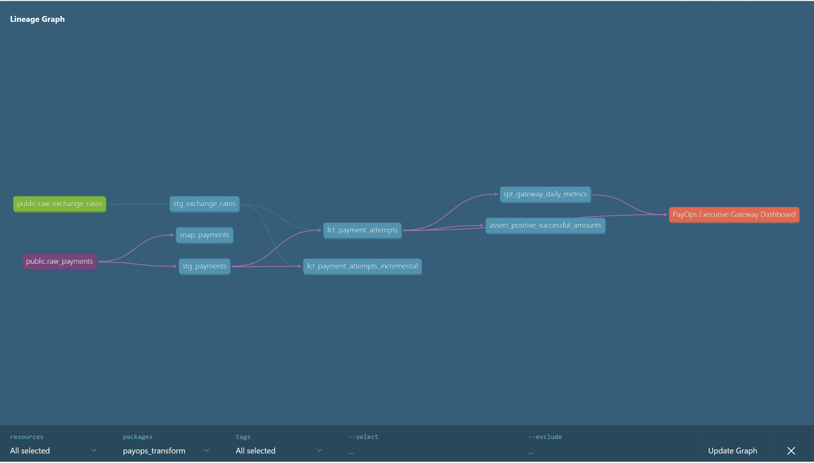

# 🚀 PayOps (Payments Operations) Analytics Engineering Pipeline

A production-grade, end-to-end Payments Operations data pipeline built using **Python, PostgreSQL, and dbt Core**. This project simulates real-world data engineering workflows—handling raw payment stream ingestion, multi-currency conversion, incremental loading, historical status auditing, automated testing, and BI reporting exposure.

---

## 📊 Pipeline Architecture & Lineage

The pipeline follows a modern modular data stack design, transforming raw transactional data through clean staging views into business-ready analytical marts and executive dashboard exposures.



---

## 🛠️ Tech Stack & Tools

- **Orchestration & Transformation:** dbt Core (v1.13)
- **Data Warehouse / Database:** PostgreSQL (`payops_db`)
- **Data Engineering & Automation:** Python (`pandas`, `SQLAlchemy`)
- **Quality Assurance:** dbt automated tests (uniqueness, not-null, referential integrity, custom business logic)
- **Version Control:** Git & GitHub

---

## 🏗️ Project Architecture Breakdown

1. **Ingestion & Staging (`stg_payments`, `stg_exchange_rates`)**
   - Cleans, casts, and standardizes raw parquet ingestion tables (`raw_payments`, `raw_exchange_rates`).
   - Normalizes strings, dates, and currency formats to establish a reliable single source of truth.

2. **Core Analytics Marts & Currency Normalization (`fct_payment_attempts`)**
   - Integrates transaction details with daily multi-currency exchange rates.
   - Dynamically calculates **USD equivalent amounts (`amount_in_usd`)** to enable unified global financial reporting.
   - Tags transaction performance flags (`is_successful`).

3. **Performance Optimization (`fct_payment_attempts_incremental`)**
   - Utilizes dbt incremental models (`is_incremental()`) with unique keys to append only new records on subsequent runs rather than performing costly full-table rebuilds.

4. **Historical Auditing / SCD Type 2 Snapshots (`snap_payments`)**
   - Implements Slowly Changing Dimensions Type 2 snapshots to track lifecycle updates for payment statuses (e.g., transitions from `pending` to `success`, `refunded`, or `disputed`) with historical valid-from/valid-to timestamps.

5. **Aggregate Reporting & Downstream Exposures (`rpt_gateway_daily_metrics`)**
   - Rolls granular records up into daily gateway performance summaries tracking total volume, processor fees, and success rates.
   - Connects directly to a downstream BI exposure (`payops_executive_dashboard`) for stakeholder consumption.

---

## 🧪 Automated Testing & Data Quality

The project enforces strict data integrity constraints via automated test suites (`dbt test`):

- Primary key uniqueness and non-null checks on all entities.
- Referential integrity relationships between staging and fact tables.
- Value acceptance testing ensuring valid payment statuses (`success`, `failed`, `pending`, `refunded`, `disputed`).
- Custom singular tests verifying positive successful transaction amounts.

---

## 🚀 How to Run Locally

1. **Clone the Repository:**
   ```bash
   git clone [https://github.com/](https://github.com/)<YOUR_GITHUB_USERNAME>/payops-data-pipeline-dbt.git
   cd payops-data-pipeline-dbt
   ```
